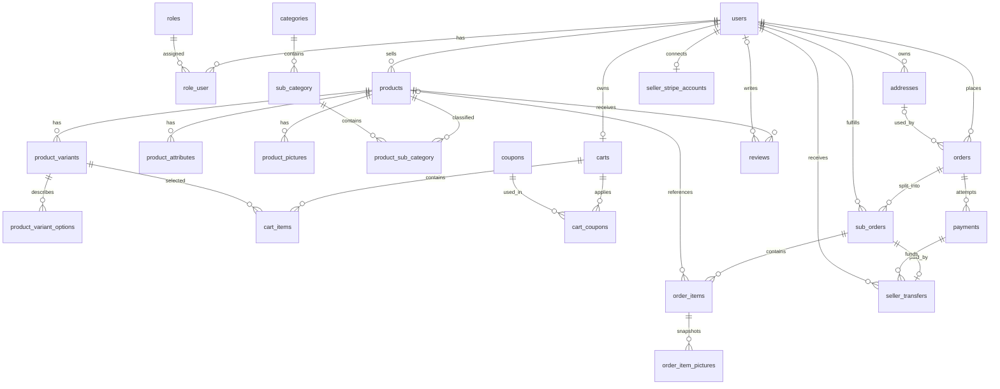

# Cartiva Database Tables

آخر تحديث: 28 أكتوبر 2026.

الملف ده بيوصف الـdatabase schema الحالية كما هي موجودة في `database/migrations`. الـmigrations هي مصدر الحقيقة لو حصل اختلاف بينها وبين التوثيق.

## نظرة عامة

المشروع يحتوي على **28 جدولًا**، مقسّمين إلى:

- المستخدمين والصلاحيات: 3 جداول.
- كتالوج المنتجات: 8 جداول.
- السلة والكوبونات والعناوين: 5 جداول.
- الطلبات: 4 جداول.
- Stripe والدفع: 4 جداول.
- التقييمات: جدول واحد.
- جداول Laravel الداخلية: 3 جداول.



## 1. المستخدمون والصلاحيات

### `users`

الحساب الأساسي لكل مستخدم، سواء كان عميلًا أو بائعًا أو مديرًا أو مندوب توصيل.

| العمود | النوع | القيود / الاستخدام |
| --- | --- | --- |
| `id` | BIGINT | Primary key |
| `first_name` | VARCHAR | الاسم الأول |
| `last_name` | VARCHAR | اسم العائلة |
| `email` | VARCHAR | Unique |
| `phone` | VARCHAR(15) | Nullable |
| `email_verified_at` | TIMESTAMP | Nullable |
| `password` | VARCHAR | Password hash |
| `remember_token` | VARCHAR | Nullable |
| `created_at`, `updated_at` | TIMESTAMP | Laravel timestamps |

### `roles`

تعريف الأدوار المتاحة. الـmigration تضيف: `user`, `seller`, `admin`, `delivery`.

| العمود | النوع | القيود / الاستخدام |
| --- | --- | --- |
| `id` | BIGINT | Primary key |
| `name` | VARCHAR(30) | Unique، القيمة المستخدمة داخل الكود |
| `label` | VARCHAR(50) | الاسم الظاهر للمستخدم |

### `role_user`

Pivot table لعلاقة Many-to-Many بين المستخدمين والأدوار؛ المستخدم يمكن أن يمتلك أكثر من دور.

| العمود | النوع | القيود / الاستخدام |
| --- | --- | --- |
| `role_id` | BIGINT | FK → `roles.id`, cascade delete |
| `user_id` | BIGINT | FK → `users.id`, cascade delete |

المفتاح الأساسي مركب من `(role_id, user_id)`، وبالتالي لا يمكن تكرار نفس الدور للمستخدم.

## 2. كتالوج المنتجات

### `products`

بيانات المنتج المشتركة بين كل نسخه. المخزون لا يُحفظ هنا؛ مصدره `product_variants.stock`.

| العمود | النوع | القيود / الاستخدام |
| --- | --- | --- |
| `id` | BIGINT | Primary key |
| `title` | VARCHAR(255) | اسم المنتج |
| `slug` | VARCHAR(255) | Unique داخل منتجات نفس البائع |
| `description` | TEXT | وصف المنتج |
| `cover_image` | VARCHAR | Nullable، مسار الصورة الرئيسية |
| `price` | DECIMAL(10,2) | السعر الأساسي |
| `discount_amount` | DECIMAL(10,2) | Default `0`، قيمة خصم ثابتة وليست نسبة |
| `seller_id` | BIGINT | FK → `users.id`, cascade delete |
| `is_active` | BOOLEAN | Default `true` |
| `sold_count` | INTEGER | Default `0` |
| `rating_avg` | DECIMAL(2,1) | Default `0`، متوسط محفوظ للتقييمات |
| `rating_count` | INTEGER | Default `0` |
| `created_at`, `updated_at` | TIMESTAMP | Laravel timestamps |

القيود والـindexes:

- Unique: `(seller_id, slug)`.
- Index: `(is_active, created_at)` لعرض المنتجات النشطة.
- Index: `(seller_id, is_active, created_at)` لصفحات البائع.

### `product_variants`

كل row يمثل نسخة قابلة للبيع من المنتج، مثل «أسود / 256GB». المنتج البسيط يمتلك Variant واحدة بدون options.

| العمود | النوع | القيود / الاستخدام |
| --- | --- | --- |
| `id` | BIGINT | Primary key |
| `product_id` | BIGINT | FK → `products.id`, cascade delete |
| `sku` | VARCHAR(100) | Nullable، indexed |
| `price` | DECIMAL(10,2) | Nullable؛ عند غيابه يُستخدم سعر المنتج |
| `stock` | UNSIGNED INTEGER | Default `0` |
| `option_signature` | CHAR(64) | SHA-256 لتركيبة الخيارات بعد normalization |
| `created_at`, `updated_at` | TIMESTAMP | Laravel timestamps |

القيود والـindexes:

- Unique: `(product_id, option_signature)` لمنع تكرار نفس تركيبة الخيارات.
- Index: `(product_id, stock, price)` للفلترة وحساب السعر والمخزون.
- `option_signature` تظل Nullable لأن تحديث النسخ قد يحتاج تفريغها مؤقتًا قبل تبديل التركيبات.

### `product_variant_options`

اختيارات مرنة للـVariant، بدل أعمدة ثابتة مثل `size` و`color`.

| العمود | النوع | القيود / الاستخدام |
| --- | --- | --- |
| `id` | BIGINT | Primary key |
| `product_variant_id` | BIGINT | FK → `product_variants.id`, cascade delete |
| `key` | VARCHAR(50) | اسم الاختيار بعد normalization، مثل `color` |
| `value` | VARCHAR(100) | قيمة الاختيار، مثل `Black` |

القيود والـindexes:

- Unique: `(product_variant_id, key)`؛ لا يتكرر نفس اسم الاختيار داخل النسخة.
- Index: `(key, value, product_variant_id)` لفلترة المنتجات بالاختيارات.
- لا يحتوي الجدول على timestamps.

### `product_attributes`

مواصفات وصفية للمنتج وليست نسخة قابلة للبيع، مثل الخامة والوزن والقدرة.

| العمود | النوع | القيود / الاستخدام |
| --- | --- | --- |
| `id` | BIGINT | Primary key |
| `product_id` | BIGINT | FK → `products.id`, cascade delete |
| `key` | VARCHAR(50) | اسم الخاصية |
| `value` | VARCHAR(255) | القيمة النصية |
| `numeric_value` | DECIMAL(15,4) | Nullable، للبحث بالنطاقات الرقمية |
| `unit` | VARCHAR(30) | Nullable، مثل `GB`, `kg`, `W` |

القيود والـindexes:

- Unique: `(product_id, key, value)`.
- Index نصي: `(key, value, product_id)`.
- Index رقمي: `(key, unit, numeric_value, product_id)`.

### `product_pictures`

صور المنتج الإضافية. الصورة الرئيسية موجودة في `products.cover_image`.

| العمود | النوع | القيود / الاستخدام |
| --- | --- | --- |
| `id` | BIGINT | Primary key |
| `product_id` | BIGINT | FK → `products.id`, cascade delete |
| `picture` | VARCHAR(255) | مسار الصورة |

### `categories`

| العمود | النوع | القيود / الاستخدام |
| --- | --- | --- |
| `id` | BIGINT | Primary key |
| `title` | VARCHAR(50) | اسم التصنيف الرئيسي |
| `slug` | VARCHAR | Unique |

### `sub_category`

اسم الجدول Singular كما هو موجود في الـmigration الحالية.

| العمود | النوع | القيود / الاستخدام |
| --- | --- | --- |
| `id` | BIGINT | Primary key |
| `title` | VARCHAR(50) | اسم التصنيف الفرعي |
| `slug` | VARCHAR | Unique |
| `category_id` | BIGINT | FK → `categories.id`, cascade delete |

### `product_sub_category`

Pivot table يسمح بوضع المنتج في أكثر من تصنيف فرعي.

| العمود | النوع | القيود / الاستخدام |
| --- | --- | --- |
| `id` | BIGINT | Primary key |
| `product_id` | BIGINT | FK → `products.id`, cascade delete |
| `sub_category_id` | BIGINT | FK → `sub_category.id`, cascade delete |

Unique: `(product_id, sub_category_id)`.

## 3. العناوين والسلة والكوبونات

### `addresses`

| العمود | النوع | القيود / الاستخدام |
| --- | --- | --- |
| `id` | BIGINT | Primary key |
| `user_id` | BIGINT | FK → `users.id`, cascade delete |
| `country` | VARCHAR(2) | ISO country code |
| `city` | VARCHAR(50) | المدينة |
| `street` | VARCHAR(255) | Nullable |
| `is_default` | BOOLEAN | Default `false` |
| `note` | VARCHAR(255) | Nullable |
| `latitude` | DECIMAL(10,7) | Nullable |
| `longitude` | DECIMAL(10,7) | Nullable |
| `created_at`, `updated_at` | TIMESTAMP | Laravel timestamps |

Index: `(user_id, is_default)`.

### `coupons`

الكوبون مملوك لبائع، ويُطبق على منتجات هذا البائع فقط داخل السلة.

| العمود | النوع | القيود / الاستخدام |
| --- | --- | --- |
| `id` | BIGINT | Primary key |
| `code` | VARCHAR(50) | Unique داخل كوبونات نفس البائع |
| `percentage` | FLOAT | نسبة الخصم |
| `expire_date` | DATE | تاريخ الانتهاء |
| `max_usage` | INTEGER | أقصى عدد استخدامات |
| `used_count` | INTEGER | Default `0` |
| `seller_id` | BIGINT | FK → `users.id`, cascade delete |
| `is_active` | BOOLEAN | Default `true` |
| `created_at`, `updated_at` | TIMESTAMP | Laravel timestamps |

Unique: `(code, seller_id)`.

### `carts`

| العمود | النوع | القيود / الاستخدام |
| --- | --- | --- |
| `id` | BIGINT | Primary key |
| `user_id` | BIGINT | FK → `users.id`, cascade delete |
| `created_at`, `updated_at` | TIMESTAMP | Laravel timestamps |

قاعدة البيانات لا تفرض Unique على `user_id` حاليًا؛ منطق التطبيق هو المسؤول عن استخدام سلة واحدة للمستخدم.

### `cart_items`

| العمود | النوع | القيود / الاستخدام |
| --- | --- | --- |
| `id` | BIGINT | Primary key |
| `cart_id` | BIGINT | FK → `carts.id`, cascade delete |
| `product_id` | BIGINT | FK → `products.id`, cascade delete |
| `product_variant_id` | BIGINT | FK → `product_variants.id`, cascade delete |
| `quantity` | INTEGER | الكمية المطلوبة |
| `created_at`, `updated_at` | TIMESTAMP | Laravel timestamps |

Unique: `(cart_id, product_variant_id)`؛ نفس النسخة لا تتكرر كسطرين داخل السلة.

### `cart_coupons`

| العمود | النوع | القيود / الاستخدام |
| --- | --- | --- |
| `id` | BIGINT | Primary key |
| `cart_id` | BIGINT | FK → `carts.id`, cascade delete |
| `coupon_id` | BIGINT | FK → `coupons.id`, cascade delete |
| `created_at`, `updated_at` | TIMESTAMP | Laravel timestamps |

Unique: `(cart_id, coupon_id)`.

## 4. الطلبات

### `orders`

الطلب الرئيسي الخاص بالمشتري. يمكن أن يحتوي على منتجات من أكثر من بائع.

| العمود | النوع | القيود / الاستخدام |
| --- | --- | --- |
| `id` | BIGINT | Primary key |
| `user_id` | BIGINT | FK → `users.id`, cascade delete |
| `subtotal` | DECIMAL(10,2) | الإجمالي قبل الخصومات |
| `discount` | DECIMAL(10,2) | Default `0` |
| `total_price` | DECIMAL(10,2) | المبلغ النهائي |
| `phone` | VARCHAR(15) | رقم التواصل وقت الطلب |
| `address_id` | BIGINT | Nullable FK → `addresses.id`, null on delete |
| `status` | ENUM | `pending`, `processing`, `shipped`, `completed`, `cancelled` |
| `payment_status` | ENUM | `pending`, `paid`, `failed`, `refunded` |
| `payment_method` | ENUM | `cash`, `card`, `wallet` |
| `created_at`, `updated_at` | TIMESTAMP | Laravel timestamps |

Indexes: `(user_id, status)` و`payment_status`.

### `sub_orders`

كل Order تنقسم إلى Sub-order واحدة لكل بائع مشارك.

| العمود | النوع | القيود / الاستخدام |
| --- | --- | --- |
| `id` | BIGINT | Primary key |
| `order_id` | BIGINT | FK → `orders.id`, cascade delete |
| `seller_id` | BIGINT | FK → `users.id`, cascade delete |
| `subtotal` | DECIMAL(10,2) | إجمالي منتجات البائع قبل الخصم |
| `discount` | DECIMAL(10,2) | Default `0` |
| `total_price` | DECIMAL(10,2) | إجمالي البائع النهائي |
| `status` | ENUM | نفس حالات `orders.status` |
| `created_at`, `updated_at` | TIMESTAMP | Laravel timestamps |

- Unique: `(order_id, seller_id)`.
- Index: `(seller_id, status)` للـseller dashboard.

### `order_items`

Snapshot للمنتج والـVariant وقت الشراء. تعديل المنتج لاحقًا لا يغيّر بيانات الطلب القديمة.

| العمود | النوع | القيود / الاستخدام |
| --- | --- | --- |
| `id` | BIGINT | Primary key |
| `sub_order_id` | BIGINT | FK → `sub_orders.id`, cascade delete |
| `product_id` | BIGINT | Nullable FK → `products.id`, null on delete |
| `title` | VARCHAR(255) | Snapshot |
| `slug` | VARCHAR(255) | Snapshot |
| `description` | TEXT | Snapshot |
| `cover_image` | VARCHAR(300) | Nullable snapshot |
| `price_at_purchase` | DECIMAL(10,2) | سعر الوحدة وقت الشراء |
| `variant_sku` | VARCHAR(100) | Nullable snapshot |
| `variant_options` | JSON | Nullable snapshot للخيارات الديناميكية |
| `quantity` | UNSIGNED INTEGER | الكمية |
| `created_at_snapshot` | TIMESTAMP | Nullable، نسخة من تاريخ إنشاء المنتج |

لا توجد أعمدة `size` أو `color`؛ كل الاختيارات محفوظة داخل `variant_options`.

### `order_item_pictures`

| العمود | النوع | القيود / الاستخدام |
| --- | --- | --- |
| `id` | BIGINT | Primary key |
| `order_item_id` | BIGINT | FK → `order_items.id`, cascade delete |
| `image_path` | VARCHAR(300) | Snapshot لمسار صورة المنتج |

## 5. Stripe والدفع

### `seller_stripe_accounts`

علاقة One-to-One بين البائع وحساب Stripe Connect.

| العمود | النوع | القيود / الاستخدام |
| --- | --- | --- |
| `id` | BIGINT | Primary key |
| `seller_id` | BIGINT | Unique FK → `users.id`, restrict delete |
| `stripe_account_id` | VARCHAR | Unique |
| `onboarding_status` | VARCHAR | Default `pending` |
| `payouts_status` | VARCHAR | Nullable |
| `transfers_status` | VARCHAR | Nullable |
| `requirements_due` | JSON | Nullable، متطلبات Stripe المتبقية |
| `disabled_reason` | VARCHAR | Nullable |
| `last_synced_at` | TIMESTAMP | Nullable |
| `created_at`, `updated_at` | TIMESTAMP | Laravel timestamps |

استخدام `restrictOnDelete` يمنع حذف Seller مرتبط بحساب Stripe بالخطأ.

### `stripe_webhook_events`

سجل idempotency للـwebhooks حتى لا يعالج التطبيق نفس event مرتين.

| العمود | النوع | القيود / الاستخدام |
| --- | --- | --- |
| `id` | BIGINT | Primary key |
| `event_id` | VARCHAR | Unique Stripe event ID |
| `type` | VARCHAR | Event type |
| `processed_at` | TIMESTAMP | Nullable |
| `created_at`, `updated_at` | TIMESTAMP | Laravel timestamps |

### `payments`

يمثل محاولات الدفع الخاصة بالطلب، وليس فقط نتيجة الدفع الأخيرة.

| العمود | النوع | القيود / الاستخدام |
| --- | --- | --- |
| `id` | BIGINT | Primary key |
| `order_id` | BIGINT | FK → `orders.id`, cascade delete |
| `provider` | VARCHAR | Default `stripe` |
| `provider_payment_id` | VARCHAR | Nullable, unique |
| `checkout_session_id` | VARCHAR | Nullable, unique |
| `idempotency_key` | UUID | Unique |
| `amount_minor` | UNSIGNED BIGINT | المبلغ بأصغر وحدة للعملة |
| `currency` | CHAR(3) | ISO currency code، مثل `egp` |
| `status` | VARCHAR | Default `creating` |
| `paid_at` | TIMESTAMP | Nullable |
| `created_at`, `updated_at` | TIMESTAMP | Laravel timestamps |

Index: `(order_id, status)`.

### `seller_transfers`

يمثل تحويل نصيب Sub-order واحدة من رصيد المنصة إلى حساب البائع المتصل على Stripe. وجود Unique على `sub_order_id` يمنع إنشاء تحويلين لنفس نصيب البائع.

| العمود | النوع | القيود / الاستخدام |
| --- | --- | --- |
| `id` | BIGINT | Primary key |
| `sub_order_id` | BIGINT | Unique FK → `sub_orders.id`, cascade delete |
| `payment_id` | BIGINT | FK → `payments.id`, cascade delete |
| `seller_id` | BIGINT | FK → `users.id`, cascade delete |
| `stripe_account_id` | VARCHAR | Nullable، snapshot لحساب البائع المستلم |
| `stripe_transfer_id` | VARCHAR | Nullable, unique Stripe Transfer ID |
| `idempotency_key` | UUID | Unique، يمنع تكرار التحويل عند إعادة المحاولة |
| `amount_minor` | UNSIGNED BIGINT | نصيب البائع بعملة الطلب وبأصغر وحدة لها |
| `currency` | CHAR(3) | عملة الطلب الأصلية، مثل `egp` |
| `settlement_amount_minor` | UNSIGNED BIGINT | Nullable، نصيب البائع الإجمالي بعد تسوية Stripe وتحويل العملة وقبل الرسوم |
| `settlement_currency` | CHAR(3) | Nullable، عملة رصيد Stripe التي يجب تنفيذ الـTransfer بها، مثل `usd` |
| `stripe_fee_minor` | UNSIGNED BIGINT | Nullable، نصيب البائع النسبي من رسوم Stripe الفعلية بعملة التسوية |
| `platform_fee_minor` | UNSIGNED BIGINT | Nullable، عمولة Cartiva بعملة التسوية |
| `platform_fee_bps` | UNSIGNED SMALLINT | Nullable، Snapshot لنسبة عمولة المنصة بالـbasis points؛ القيمة `500` تعني 5% |
| `transfer_amount_minor` | UNSIGNED BIGINT | Nullable، صافي المبلغ المرسل لحساب البائع بعد خصم الرسوم والعمولة |
| `status` | VARCHAR | `pending`, `processing`, `succeeded`, `failed`, `blocked`, أو `skipped` |
| `failure_reason` | TEXT | Nullable، سبب التعطيل أو الفشل |
| `attempted_at` | TIMESTAMP | Nullable، آخر وقت بدأت فيه محاولة |
| `transferred_at` | TIMESTAMP | Nullable، وقت نجاح Stripe Transfer |
| `created_at`, `updated_at` | TIMESTAMP | Laravel timestamps |

Indexes: `(seller_id, status)` و`(payment_id, status)`.

## 6. التقييمات

### `reviews`

يربط تقييمًا واحدًا من المستخدم بالمنتج. حذف المستخدم يحتفظ بالتقييم ويحوّل `user_id` إلى `NULL`.

| العمود | النوع | القيود / الاستخدام |
| --- | --- | --- |
| `id` | BIGINT | Primary key |
| `user_id` | BIGINT | Nullable FK → `users.id`, null on delete |
| `product_id` | BIGINT | FK → `products.id`, cascade delete |
| `comment` | VARCHAR(1000) | Nullable |
| `rating` | UNSIGNED TINYINT | قيمة التقييم |
| `created_at`, `updated_at` | TIMESTAMP | Laravel timestamps |

Unique: `(user_id, product_id)` لمنع المستخدم من تقييم نفس المنتج مرتين. التحقق من أن التقييم بين 1 و5 ومن أن المستخدم اشترى المنتج موجود في منطق التطبيق.

## 7. جداول Laravel الداخلية

### `password_reset_tokens`

| العمود | النوع | القيود / الاستخدام |
| --- | --- | --- |
| `email` | VARCHAR | Primary key |
| `token` | VARCHAR | Reset token hash |
| `created_at` | TIMESTAMP | Nullable |

### `personal_access_tokens`

جدول Laravel Sanctum للـAPI tokens. يحتوي على polymorphic `tokenable_type` و`tokenable_id`، و`name`, `token`, `abilities`, `last_used_at`, `expires_at`, والتواريخ. `token` قيمة Unique.

### `failed_jobs`

يسجل الـqueue jobs الفاشلة. يحتوي على `uuid` كقيمة Unique، و`connection`, `queue`, `payload`, `exception`, و`failed_at`.

## ملاحظات تصميم مهمة

1. المخزون موجود في `product_variants` فقط، وليس في `products`.
2. `product_variant_options` للاختيارات التي تغيّر النسخة المباعة؛ `product_attributes` للمواصفات الوصفية.
3. Order واحدة تنقسم إلى Sub-order لكل Seller.
4. `order_items` تحفظ snapshot حتى تظل الفاتورة التاريخية صحيحة بعد تعديل أو حذف المنتج.
5. `payments.amount_minor` يستخدم أصغر وحدة للعملة لتجنب أخطاء الـfloating point.
6. `stripe_webhook_events.event_id` يمنع معالجة Webhook واحدة أكثر من مرة.
7. حذف Product يحذف variants/options/attributes/pictures، لكنه يترك `order_items` ويحوّل `product_id` فيها إلى `NULL`.
8. `seller_transfers.sub_order_id` يضمن Transfer واحدة لكل نصيب بائع، و`idempotency_key` يحمي إعادة طلب Stripe من التكرار.
9. حق البائع يظل محفوظًا في `amount_minor/currency` بعملة الطلب، بينما `settlement_amount_minor/settlement_currency` يحفظان نصيبه الإجمالي بعملة رصيد Stripe قبل خصم الرسوم؛ لأن Stripe قد تقبل EGP وتسوي الرصيد بالدولار.
10. صافي تحويل البائع يساوي نصيبه من التسوية ناقص نصيبه النسبي من رسوم Stripe الفعلية وعمولة Cartiva. تخزين كل جزء منفصلًا يحافظ على أثر محاسبي واضح.

## قائمة الجداول السريعة

```text
users
roles
role_user
products
product_variants
product_variant_options
product_attributes
product_pictures
categories
sub_category
product_sub_category
addresses
coupons
carts
cart_items
cart_coupons
orders
sub_orders
order_items
order_item_pictures
seller_stripe_accounts
stripe_webhook_events
payments
seller_transfers
reviews
password_reset_tokens
personal_access_tokens
failed_jobs
```
